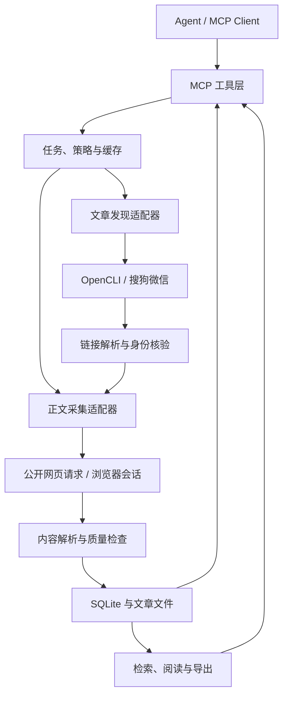

# 微信公众号文章采集 MCP 实现方案

- 文档版本：0.1
- 整理日期：2026-10-30
- 项目名称：`wechat-crawler-mcp`
- 文档状态：待实施设计；不代表已完成代码、登录验证或真实采集测试。
- 适用环境：Windows、本地单用户、由 agent 启动 MCP 服务。
- 产品定位：面向任意主题的微信公众号文章发现、采集、归档、检索与导出服务。

## 1. 目标与约定

让 agent 通过稳定的 MCP 工具完成以下操作：

1. 获取单篇公众号文章的可访问正文。
2. 按关键词发现候选文章，再选择或批量采集。
3. 根据显式链接列表建立本地文章资料库。
4. 检索、阅读、引用和导出已经采集的内容。
5. 在采集源具备相应能力时，解析公众号身份、读取文章列表或执行增量更新。

新闻、行业分析、政策解读、教程、产品介绍、文献解读等使用相同的接口和数据模型。MCP 本身不依赖大模型，不要求模型 API Key；主题判断、摘要、评价、翻译和分析由调用方 agent 完成。

本文中“必须”表示实现或验收要求，“建议”表示可以根据真实环境调整的默认选择。所有接口、字段和目录均为拟定契约，尚未实现。

## 2. 能力范围与交付边界

| 输入或操作 | 目标行为 | 首次交付范围 |
| --- | --- | --- |
| 单篇微信文章 URL | 解析文章身份、元数据、正文和媒体引用 | 必须支持普通可访问图文 |
| 多篇文章 URL | 批量采集、去重、失败记录和结果导出 | 必须支持 |
| 任意关键词 | 搜索候选文章，解析最终链接，按需抓取 | 必须完成真实环境闭环验证 |
| 本地资料库查询 | 按关键词、公众号、日期检索已保存正文 | 必须支持 |
| 公众号名称或种子文章 | 返回可核验身份或候选账号 | 条件支持 |
| 公众号历史列表 | 分页发现该账号文章 | 仅在数据源探测通过后启用 |
| 公众号增量同步 | 从上次检查点继续发现和采集 | 按来源声明覆盖范围 |
| RSS、JSON、既有归档 | 导入链接或内容 | 后续扩展 |
| OCR、音视频转录 | 从图片或媒体提取文字 | 后续扩展 |

首次交付的完整闭环为：

**搜索或输入链接 → 解析链接 → 抓取并校验 → 入库与去重 → 阅读或检索 → 导出。**

以下内容不属于首次交付的保证：

- 微信全站完整召回、任意公众号全量历史、已删除文章恢复。
- 付费或无访问权限的正文。
- 图片文字识别、音视频下载与转录。
- 阅读数、点赞数、在看数、评论等互动数据。
- 发布文章、操作草稿箱、评论、关注或发送消息。
- 远程多租户服务、Web 管理后台和持续无人值守调度。

## 3. 已核实的参考项目与选型依据

以下事实来自 2026-10-30 的 GitHub 源码、文档和维护公告核对；本项目尚未实际登录或测试这些上游路径。实施阶段必须再次验证真实可用性。

| 项目 | 可借鉴内容 | 已知边界 | 本项目采用方式 |
| --- | --- | --- | --- |
| [OpenCLI](https://github.com/jackwener/OpenCLI/blob/main/docs/adapters/browser/weixin.md) | 本地浏览器会话、搜狗微信搜索、正文转 Markdown | 搜索返回搜狗链接；不自带完整的搜索到归档闭环 | 首期采集适配器 |
| [wechat-article-exporter](https://github.com/wechat-article/wechat-article-exporter/issues/200) | 正文处理、图片归档、过滤、导出与缓存设计 | 作者于 2026-07-30 公告上游核心接口关闭并停止维护 | 参考设计，不依赖旧历史接口 |
| [wewe-rss](https://github.com/cooderl/wewe-rss) | 订阅模型、增量任务、RSS 和缓存 | 仓库于 2026-05-11 归档 | 参考设计，可选导入兼容 |
| [we-mp-rss](https://github.com/rachelos/we-mp-rss/blob/main/docs/weread-mp.md) | 多采集源、任务与授权状态 | 当前微信读书文档说明只返回最新一篇，无法回补历史 | 参考能力声明与状态处理 |

特别注意：

1. OpenCLI 的微信搜索适配器当前每页最多返回 10 条，包含搜狗结果 URL、标题、摘要和时间原文，没有稳定公众号身份。需要自行实现跳转解析和正文后的身份核验。
2. OpenCLI 下载适配器可能以结果行的 `status` 表示失败，必须同时检查进程结果、业务状态和正文有效性。
3. OpenCLI 除内置适配器外还可加载用户适配器和插件。锁定 npm 版本时，也必须记录实际适配器来源、版本或哈希，避免同名覆盖改变行为。
4. 本方案不依赖官方公众号 API 提供任意第三方公众号搜索或历史能力；已授权自有账号可以在后续作为独立来源接入。
5. 复用第三方代码时，必须核对实际版本的许可证并保留相应声明。源码参考与运行依赖分别记录。

## 4. 技术方案

| 层次 | 基线选择 | 说明 |
| --- | --- | --- |
| 运行时 | Node.js 24 LTS、TypeScript | 与 OpenCLI 共用运行时；锁定受测版本 |
| MCP | 官方 TypeScript SDK | 以官方稳定发行版和目标客户端兼容性为准 |
| 本地传输 | stdio | 由 agent 客户端启动服务 |
| 浏览器采集 | OpenCLI + Browser Bridge | 使用专门的采集会话或浏览器 profile |
| 公开网页请求 | Node.js HTTP 客户端 | 用于无需浏览器即可取得的公开文章 |
| 内容处理 | DOM/HTML 规则、Markdown 转换 | 优先复用受测 OpenCLI 产物，补充统一校验和结构化解析 |
| 数据库 | SQLite | 元数据、任务、检查点、索引和导出记录 |
| 文章文件 | 本地文件目录 | 正文、媒体和归档产物 |
| 验证 | 单元测试、契约测试、真实样本验收 | 不以模拟测试代替上游可用性验证 |

首期不引入 Redis、消息中间件、独立向量数据库或模型服务。SQLite 驱动须在可行性阶段确认 Node.js 24 与 Windows 安装兼容性。

MCP 官方 SDK 的 API 与包名按实际锁定版本实现，不照搬旧教程。必须完成目标客户端的初始化、工具列举、工具调用、结构化输出和取消处理测试。stdio 的 stdout 只写协议消息，诊断日志写 stderr。

### 4.1 结构



### 4.2 适配器职责

| 适配器 | 职责 | 首期状态 |
| --- | --- | --- |
| `opencli_sogou` | 外部关键词发现、搜狗结果读取 | 必须验证 |
| `wechat_link_resolver` | 搜狗跳转、微信短链接和最终链接解析 | 必须实现并验证 |
| `public_http` | 读取公开微信文章 HTML | 支持时优先使用 |
| `opencli_browser` | 使用本地浏览器读取可见内容或复用下载能力 | 首期浏览器兜底 |
| `feed_import` | RSS/JSON Feed 导入 | 后续扩展 |
| `account_history` | 公众号列表与历史发现 | 数据源验证通过后实现 |

“HTTP → 浏览器”切换只用于同一允许访问的文章；实际采用的方法和切换原因必须返回。不得通过切换路径绕过付费或权限限制。

## 5. 能力声明与覆盖范围

### 5.1 每个来源独立声明能力

能力至少包含：

- `discover_articles`：外部关键词发现。
- `resolve_account`：识别目标公众号。
- `fetch_article`：已知链接抓取。
- `fetch_latest`：获取最新文章。
- `list_history`：分页历史列表。
- `incremental_sync`：依据检查点增量发现。

每项能力的状态为 `available`、`unverified`、`needs_auth`、`temporarily_unavailable` 或 `unsupported`，并附最近检查时间和原因。配置存在不等于能力已可用。

启动时执行轻量环境检查；真实请求继续更新来源状态。持续失败时暂时熔断该来源并报告恢复条件，不能无限重试。

### 5.2 统一覆盖信息

搜索、列表和采集任务返回以下覆盖字段：

| 字段 | 含义 |
| --- | --- |
| `provider` | 实际使用的采集源 |
| `mode` | `url_list`、`search_results`、`latest_only`、`history_pages`、`local_library` 或 `imported` |
| `checked_count` | 已实际检查的输入或候选数量 |
| `returned_count` | 本次返回数量 |
| `truncated` | 是否因数量、页数、时间或输出上限截断 |
| `may_have_gaps` | 是否可能存在发现缺口 |
| `has_more` | 是否还有结果；不能确定时为 `null` |
| `next_cursor` | 可继续读取时的游标 |
| `stop_reason` | 正常结束、达到上限、认证、验证、限流、超时或来源不可用等 |

外部搜索不声明微信全站穷尽。`latest_only` 必须标记可能有缺口；任务处理完显式 URL 列表，只表示输入列表已处理完，不表示目标公众号已采集完整。

不支持历史列表时必须返回能力错误，不能用空数组表示“该账号没有历史文章”。

## 6. 统一数据模型

### 6.1 区分三种身份

1. **目标公众号**：文章的发布主体，保存本地账号 ID、名称、可得的 `biz` 和来源映射。
2. **采集会话**：浏览器 profile、来源登录状态和连接标识，不向 agent 暴露凭据。
3. **文章**：具体一篇图文，多图文中的子文章分别建档。

公众号名称不能作为唯一标识。重名时返回候选或要求补充种子链接，不能自动合并。`biz`、微信读书 ID 与其他 provider ID 只有存在可验证证据时才建立映射，并保存映射来源。

### 6.2 文章核心字段

| 字段组 | 字段或内容 |
| --- | --- |
| 身份 | `article_id`、`account_id`、可得的 `biz/mid/idx` |
| 链接 | `discovered_url`、`canonical_url`、链接别名 |
| 元数据 | 标题、公众号名称、作者、简介、发布时间原文和标准时间 |
| 来源 | provider、抓取方法、发现时间、采集时间 |
| 正文 | Markdown、纯文本、结构化内容块、正文版本 |
| 媒体 | 图片与媒体引用、下载状态、本地相对路径 |
| 外链 | URL、显示文字、所在内容块 |
| 质量 | 元数据状态、正文状态、媒体状态、警告 |
| 版本 | 内容哈希、解析器版本、上次成功与最近尝试时间 |

元数据不能确认时保存 `null` 和原因。搜狗的相对时间仅作为发现时间线索，不能未经核实变为文章准确发布时间。标准时间使用带时区的 ISO 8601，界面默认按 `Asia/Shanghai` 展示。

### 6.3 内容块

内容块至少包含 `block_id`、`type`、`order`、文本或资源引用，类型支持：

- `heading`、`paragraph`、`list`、`quote`。
- `image`、`table`、`code`。
- `audio_reference`、`video_reference`、`attachment_reference`。
- `unsupported`：记录已发现但当前无法完整表达的内容及原因。

`block_id` 在同一正文版本内稳定，引用使用 `article_id + content_version + block_id`。刷新后不保证块 ID 不变，必须保留版本信息。

### 6.4 状态分别记录

| 状态对象 | 取值 |
| --- | --- |
| 元数据 | `complete`、`partial` |
| 正文 | `not_fetched`、`complete`、`partial`、`blocked`、`failed`、`unavailable` |
| 媒体 | `skipped`、`complete`、`partial`、`failed` |

正文 `complete` 表示当前可访问正文块已提取且无已知截断，至少存在一个有效正文块；不代表已 OCR、媒体已转录或所有图片已下载。验证码、导航和提示文字不能当作正文块。

纯图片文章可以保存完整的可见图片块，但必须标记 `image_text_not_extracted`；已知截断、预览正文或不支持的关键内容标为 `partial`。正文成功、部分图片下载失败时，正文状态仍保留成功。

一次刷新失败不得覆盖上次成功正文。保留最近尝试状态、原成功版本和缓存时间，并向调用方明确说明正在返回旧缓存。

### 6.5 去重与版本

- 能完整取得时，使用 `biz + mid + idx` 建立文章唯一身份；缺字段时不能硬拼成唯一键。
- 回退到规范 URL，并维护短链接、长链接和发现链接的别名关系。
- 规范化只移除已确认的跟踪参数；不得误删 `sn` 等访问或身份所需参数。
- 内容哈希用于版本和重复内容识别，不能直接合并不同公众号的转载来源。
- 标题只用于展示与查询，不用于唯一约束。
- 并发采集相同文章必须通过数据库约束或单飞机制防止重复写入。

## 7. MCP 工具契约

### 7.1 通用返回规则

每个工具提供明确的输入 schema 和输出 schema。业务输出至少包含：

- `schema_version`、`ok`、`request_id`。
- 成功时的 `data`，以及必要的 `coverage`、`warnings`。
- 失败时的 `error.code`、`message`、`retryable`、可选 `retry_after_seconds`、`required_action`。

已处理的业务失败采用 MCP 工具错误结果并设置 `isError: true`，同时尽可能提供结构化错误详情和兼容客户端的文本说明。参数或协议错误交由 SDK 的相应机制处理。

批量任务部分成功通过任务状态和逐项错误表达；获取一个失败任务的状态本身仍是成功的查询。

默认返回小结果。正文通过阅读工具按块分页，明确下一页，不静默截断。游标必须绑定原查询与来源，不包含 Cookie、Token 或其他凭据。

### 7.2 首期工具

| 工具 | 输入约定 | 输出约定 |
| --- | --- | --- |
| `wx_status` | 可选 `check_sources`；默认只读缓存状态 | 运行版本、来源能力、浏览器连接、授权需求、存储状态 |
| `wx_search_articles` | `query`、`page=1`、`limit=10`、可选 `provider` | 候选 ID、标题、发现链接、摘要、时间原文、元数据核验状态、覆盖信息 |
| `wx_fetch_article` | 文章 URL 或搜索候选 ID；可选 `refresh`、`download_images` | 文章 ID、元数据、正文/媒体状态、正文版本和缓存信息 |
| `wx_read_article` | `article_id`、可选正文版本、格式、游标、长度上限 | 正文块或 Markdown/文本、引用信息、下一页游标 |
| `wx_search_library` | `query`、可选账号/日期条件、分页 | 本地文章、匹配段落、排序、实际 `search_mode` |
| `wx_start_collection` | `input`、采集约束、可选幂等键 | 任务 ID、初始状态和生效配置 |
| `wx_get_job` | `job_id`、可选明细游标与失败项筛选 | 总体状态、计数、覆盖信息、逐项结果 |
| `wx_control_job` | `job_id`、`action=pause/resume/cancel` | 更新后的任务状态或不允许的状态转换 |
| `wx_export_articles` | 文章 ID 列表或任务 ID、格式、媒体选项、幂等键 | 导出任务 ID；完成后得到文件清单或资源引用 |

工具的下载、缓存写入和导出行为必须在描述中说明。agent 不需要通用 shell 或任意浏览器脚本工具即可完成采集。

工具成功、正文完整和任务计数分别判断：

| 场景 | 工具返回 | 文章与计数 |
| --- | --- | --- |
| 完整正文或其有效缓存 | `ok=true`，`isError` 不设置或为 `false` | `content_status=complete`；任务计入 `success_count` |
| 可保存的受限预览或部分正文 | `ok=true`，返回限制警告 | `content_status=partial`；任务只计入 `partial_count` |
| 刷新失败但有旧成功正文 | `ok=true`、`stale=true`，附 `last_attempt.error` 与警告 | 保留原正文状态，任务另计 `stale_count`，不能宣称刷新成功 |
| 仅有验证/限制提示、无可用正文且无缓存 | `ok=false`、`isError=true` | 不计成功；保存发现或失败记录 |

`ok=true` 只表示工具交付了可用结果，不能替代正文完整性判断。缓存过旧是否接受由任务策略决定；任务要求刷新时，旧缓存不能满足成功条件。

导出复用同一任务模型，使用 `kind=export`，采集使用 `kind=collection`。`wx_export_articles` 立即返回 `job_id`，可直接交给 `wx_get_job`；导出完成后的 `data.result` 包含 `export_id`、`manifest_path`、文件清单和部分失败项。导出创建时固定文章 ID 与正文版本清单，支持在文件边界暂停、恢复与取消；未完成导出不能标记为完整产物。

### 7.3 搜索与筛选语义

`wx_search_articles` 负责外部发现，首期只保证关键词、分页和数量约束；返回值是候选，不是已归档文章。

公众号、日期等严格筛选放在采集阶段，用正文元数据核验。来源不支持的过滤不得静默忽略；需要准确字段但字段缺失时，返回无法判断及排除原因。

日期条件使用左闭右开区间：`published_from <= published_at < published_before`。仅提供日期时按 `Asia/Shanghai` 的零点解释；发布时间不能确认的文章不通过严格日期筛选。

`wx_search_library` 只查询本地数据库，结果必须带最后成功采集时间。外部发现和本地检索不能混用“已采集”计数。

### 7.4 创建采集任务

`input` 使用可辨别的类型：

- `type=urls`：显式 URL 列表。
- `type=search`：查询词列表和外部发现来源。
- `type=account`：已核验账号 ID，仅在对应能力启用后接受。
- `type=feed/import`：后续扩展，首期不接受。

约束包含 `max_articles`、`max_discovered`、`max_pages`、`max_duration_seconds`、账号/日期条件、是否下载图片和刷新策略。

`max_articles` 是合格文章处理上限，包含接受的缓存命中、完整正文和已保存的部分正文；同一任务内同一文章只计一次。完整和部分正文分别计入 `success_count` 与 `partial_count`。任务配置 `require_complete=true` 时，部分正文只保留诊断记录，不作为合格文章归档。

`max_discovered` 是候选检查上限。失败、重复或被筛除的候选也计入检查量，防止任务为凑满合格数无限翻页。`checked_count`、`accepted_count`、`success_count`、`partial_count`、`filtered_count`、`failed_count`、`duplicate_count` 和 `stale_count` 分别返回；`stale_count` 是交叉统计，不能直接与其他计数相加。

同一幂等键和相同规范化参数返回已有任务；相同键配不同参数返回冲突。未提供幂等键时不保证任务创建去重，但文章写入仍须幂等。

### 7.5 条件工具

| 工具 | 启用条件 | 必须说明 |
| --- | --- | --- |
| `wx_resolve_account` | 账号解析来源已验证 | 重名候选、身份置信依据、来源映射 |
| `wx_list_account_articles` | 来源支持文章列表 | 历史/仅最新、页数、缺口和截断 |
| `wx_sync_account` | 来源支持定义清楚的增量发现 | 检查点、回看范围和遗漏风险 |

实现时可按配置注册条件工具；已注册但运行时不可用的工具返回明确能力错误。agent 可通过 `wx_status` 获知原因。

### 7.6 Resources 与 Prompts

首期所有必要操作必须能通过工具完成。支持资源的客户端可额外读取版本化文章资源和导出清单，使用内部 ID，不能允许任意文件路径读取。

Prompts 可作为后续使用示例扩展，不作为采集功能的依赖。

## 8. 抓取与解析流程

### 8.1 已知 URL

1. 校验输入、协议、域名和文章路径，保留必要参数。
2. 查找链接别名、文章身份与缓存；按照刷新策略返回缓存或继续。
3. 对公开文章尝试 HTTP；需要浏览器环境时使用受控会话。
4. 检查最终 URL、响应类型、验证页、删除页、权限提示和正文区域。
5. 提取元数据与正文块，保存可得的身份信息。
6. 清洗并转换 Markdown/纯文本，记录不支持内容和已知截断。
7. 依据配置处理媒体引用或下载，媒体失败独立记录。
8. 原子写入正文产物，提交元数据与版本，更新检索数据。
9. 返回文章 ID、来源、状态、警告和缓存信息。

实现时将“读取/解析”和“提交归档”拆为内部阶段。单篇工具默认解析后归档；带筛选的批量任务先取得暂存结果，核验筛选条件后才提交归档，媒体下载也在通过筛选后执行。新抓取但被过滤的文章只留发现与诊断记录，不进入正文资料库；已经在资料库中的文章即使本任务过滤掉，也不删除原归档。

### 8.2 关键词发现到归档

1. 调用外部发现适配器读取候选并保存发现记录。
2. 在受控浏览器中解析搜狗结果链接，确认最终微信文章 URL。
3. 去重后抓取，核验实际公众号、标题和发布时间。
4. 应用严格筛选，记录不匹配和无法判断的原因。
5. 将合格的完整或允许保存的部分文章入库，输出成功、部分、过滤、失败和覆盖信息。

搜狗跳转是首个必须实测的关键环节。未通过时，关键词采集验收不通过；可以交付 URL 采集里程碑，但不能宣称通用搜索闭环已完成。

### 8.3 缓存策略

- 默认返回已成功保存的文章，并附成功采集时间和 `cache_hit`。
- `refresh=true` 发起新的抓取尝试，正文有变化时创建新版本。
- 搜索候选缓存使用可配置 TTL，不能把过期跳转链接视为永久文章地址。
- 元数据缓存、正文缓存和媒体状态分别维护。
- 上游不可用但存在旧正文时，明确返回陈旧缓存及刷新失败原因。

## 9. 任务状态、恢复与重试

### 9.1 状态

任务状态使用：

`queued`、`running`、`waiting_auth`、`waiting_verification`、`waiting_source`、`backoff`、`paused`、`interrupted`、`completed`、`completed_with_errors`、`failed`、`cancelled`。

| 事件 | 状态行为 |
| --- | --- |
| 创建任务 | 进入 `queued`，持久化输入和参数 |
| 开始执行 | 进入 `running`，逐项提交进度 |
| 登录过期或验证码 | 保存检查点，进入对应等待状态 |
| 网络或限流需退避 | 进入 `backoff`，保存下次尝试时间 |
| 用户暂停 | 在安全边界停下，进入 `paused` |
| 用户取消 | 停止调度，尽力取消在途请求，保留已成功结果 |
| 所有候选正常处理 | 进入 `completed`，即使匹配为零也可正常结束 |
| 输入已处理完，但存在部分正文或项目最终失败 | 进入 `completed_with_errors`，包括全部项目最终失败的情况 |
| 可恢复的来源故障、临时熔断且自动退避预算已耗尽 | 保存检查点，进入 `waiting_source`，等待来源恢复后显式继续 |
| 非可恢复的任务或基础设施错误 | 进入 `failed`，保存原因；修复后创建新任务 |
| 服务非正常退出 | 重启后将未完成的执行状态标记为 `interrupted` |

过滤掉不匹配文章不是失败；达到预算上限不是无限继续的理由，必须返回截断信息。

### 9.2 恢复规则

- 数据库逐项保存候选、规范 URL、尝试次数、结果和检查点。
- 同一服务进程对浏览器来源串行排队，数据库与工作目录使用单实例锁。
- 客户端停止 stdio 进程后任务不继续后台执行。
- 重启后保留已完成项，`interrupted`、人工暂停、认证等待或 `waiting_source` 任务需要明确恢复操作。
- 恢复前重新检查来源能力；分页游标失效时明确报告，不从不确定位置静默重跑。
- 后续增加常驻 worker 或系统调度时，复用任务模块和锁机制，不能同时启动两个写入者。

### 9.3 重试规则

- 网络超时和临时服务错误允许有限重试，初始最多 2 次重试，使用退避。
- 429 或来源明确限流时优先使用上游冷却时间；达到等待预算后返回可恢复状态。
- 登录、验证码、权限错误不自动连续重试。
- 删除或确定不可访问的文章不立即重试。
- 媒体失败可独立补抓，不重复下载已成功正文。
- `resume` 只恢复非终态任务；重跑终态任务通过新的采集请求完成，复用文章缓存与去重结果，但不声称自动继承旧任务游标。预期可恢复的来源故障必须进入等待状态，不能提前置为终态 `failed`。

## 10. 存储、检索与导出

### 10.1 存储布局

以下路径为拟定结构，不表示已创建：

```text
data/
  wechat.sqlite
  articles/<article_id>/<content_version>/
    article.md
    content.json
    snapshot.html
  assets/<content_hash>.<ext>
  exports/<export_id>/
    manifest.json
    ...
  logs/
```

文章路径用内部 ID，标题仅用于展示。下载和导出须处理 Windows 保留文件名、Unicode、路径长度和非法字符。文件先写临时路径再原子替换，数据库只引用已提交的完整产物；残留临时文件可在重启时清理。

`snapshot.html` 仅在实际取得 HTML 或 DOM 快照时保存，不能伪装成服务器原始响应。快照须剔除与文章无关的凭据、脚本和表单等，不直接作为可执行页面展示。

拟定逻辑表：`accounts`、`account_provider_ids`、`articles`、`article_urls`、`article_versions`、`assets`、`discoveries`、`jobs`、`job_items`、`checkpoints`、`exports`。实际建表前确定迁移版本和事务边界。

### 10.2 本地检索

首期保证中文标题、正文子串匹配，以及公众号、日期等字段过滤；查询使用参数化 SQL。返回 `search_mode=substring`，默认使用稳定排序，不将其描述为语义相关性排名。

资料量扩大后再增加 FTS5。必须验证中文分词或字符索引效果，不能假设默认 tokenizer 自然支持中文词组。索引可重建，原始正文和元数据是数据来源；FTS 返回实际检索模式、匹配片段和排序依据。

### 10.3 导出契约

| 格式 | 内容 |
| --- | --- |
| Markdown | 元数据 frontmatter、正文、可选本地媒体引用 |
| JSONL | 每行一个带 schema 版本的文章记录，保留来源、状态和结构化内容 |
| HTML | 根据清洗后的内容块生成静态阅读页，不能直接输出未经处理的源 HTML |

每次导出创建独立目录和 `manifest.json`，记录文章 ID、正文版本、文件、媒体选项和失败项。路径只能位于配置的导出根目录内，默认不覆盖已有导出。

未下载媒体时保存来源引用；已下载媒体使用相对路径；部分失败在清单和文章警告中说明。JSONL 的 `include_media` 仅表示附带媒体文件和引用，不把媒体二进制嵌入每条记录。

## 11. 错误契约

| 错误码 | 场景 | 默认处理 |
| --- | --- | --- |
| `INVALID_INPUT` | 非法 URL、参数或游标 | 修正输入 |
| `UNSUPPORTED_CAPABILITY` | 来源不支持所需能力 | 更换来源或调整请求 |
| `SOURCE_UNAVAILABLE` | 来源失效或未通过可用性验证 | 报告原因，不伪造空结果 |
| `AUTH_REQUIRED` | 会话未登录或已过期 | 等待本地重新登录 |
| `VERIFICATION_REQUIRED` | 验证码或环境验证 | 等待人工处理 |
| `RATE_LIMITED` | 来源限流 | 退避或等待 |
| `ARTICLE_DELETED` | 已确认删除 | 保存不可用状态 |
| `ACCESS_RESTRICTED` | 付费或权限限制 | 返回可见部分与限制 |
| `PARSE_FAILED` | 页面可读但无法可靠识别正文 | 保留诊断信息并修复解析器 |
| `NETWORK_ERROR` | 临时连接或请求失败 | 有限重试 |
| `IDENTITY_AMBIGUOUS` | 公众号或文章映射不确定 | 返回候选或要求种子链接 |
| `RESOURCE_NOT_FOUND` | 文章、任务或版本不存在 | 检查标识 |
| `CONFLICT` | 幂等键参数冲突、实例锁或非法状态转换 | 返回冲突原因 |

外部搜索的真实无结果返回成功空集合与明确覆盖信息；来源错误、页面结构变化和验证码不能转换为“无结果”。

## 12. 连接、权限与数据处理

- 使用专门的浏览器会话或 profile；用户在本地完成登录与验证。
- Cookie、Token、完整请求头不得进入工具输出、普通日志或导出清单。
- 内部只允许固定命令及经过校验的参数，使用参数数组启动子进程，不拼接 shell 字符串。
- 搜索与跳转域名按 provider 白名单设置，最终文章必须是允许的微信文章地址。
- HTTP、浏览器导航和媒体下载都检查目标及跳转；阻止任意本地/私有网络请求，媒体使用受控来源规则与大小限制。
- 外链首期只提取和保存，不自动递归抓取。
- 缓存、资源读取和导出限制在配置根目录，拒绝路径穿越和任意本地文件读取。
- 抓取内容作为不可信外部资料返回，不执行文章中的命令或指令。
- 若后续开放 HTTP，另行实现身份认证、Origin/Host 检查、传输保护和会话隔离；本地 stdio 方案不等于远程部署方案。

## 13. 配置与默认策略

配置文件仅保存非敏感设置；敏感会话留在浏览器或专用凭据存储。提供可提交的示例配置，实际配置、数据库、缓存和日志加入忽略规则。

| 配置项 | 首期建议默认值 |
| --- | --- |
| `transport` | `stdio` |
| `data_dir` / `export_dir` | 启动时解析为绝对路径 |
| `sources.enabled` | 仅启用已配置且通过探测的来源 |
| `browser.session` | 固定的专用采集会话 |
| `browser.concurrency_per_site` | `1` |
| `request.interval_ms` | 同站默认 3000–5000，可调整 |
| `request.timeout_seconds` | HTTP 初始 30；浏览器初始 60 |
| `retry.max_retries` | `2` |
| `search.default_limit` | `10`；按来源上限分页 |
| `collection.max_articles` | `50` |
| `collection.max_discovered` | `200` |
| `collection.max_pages` | `5` |
| `collection.max_duration_seconds` | `600`；包含执行与自动退避，排除人工等待、暂停和服务未运行时间 |
| `collection.require_complete` | `false`；允许归档明确标记的部分正文 |
| `content.max_response_chars` | 初始 12000；整块分页，超长块显式分片 |
| `media.download_images` | `false` |
| `media.max_image_bytes` | 初始 10 MiB |
| `media.max_total_bytes_per_job` | 初始 100 MiB |
| `search_cache.ttl_seconds` | 初始 600 |

这些是控制资源使用的初值，不是上游保证。来源提示、真实样本结果和实际超时应覆盖默认策略。实现时明确硬上限，并返回本次实际生效配置。

## 14. 拟定项目目录

以下目录为后续实施目标；本次仅整理设计文档。

```text
docs/
  IMPLEMENTATION_PLAN.md
src/
  server/         MCP 注册、协议与资源
  tools/          工具 schema 与处理函数
  providers/      OpenCLI、HTTP、搜索与可选来源
  browser/        会话、串行调度与固定命令执行
  resolver/       URL 校验、跳转与身份映射
  parser/         元数据、正文块、Markdown 与质量检查
  jobs/           任务、状态、恢复、重试
  storage/        数据访问、迁移、版本与去重
  search/         本地字段与全文检索
  export/         Markdown、JSONL、HTML 与清单
  config/         配置加载与校验
  shared/         公共类型、错误与日志脱敏
tests/
  fixtures/       可合法保存且已脱敏的样本
  unit/
  contract/
  integration/
config.example.json
README.md
```

解析器不直接注册 MCP 工具；工具层不直接操作浏览器 DOM；来源适配器不自行决定全局任务状态。通过统一模型与错误契约连接各层。

## 15. 实施顺序与验收关口

| 阶段 | 工作内容 | 完成条件 |
| --- | --- | --- |
| P0 可行性验证 | 环境和依赖锁定、浏览器连接、搜狗跳转、公开正文、SQLite 安装、客户端协议 | 保存真实验证记录，搜索到正文闭环通过；能力限制明确 |
| P1 核心采集 | 工具骨架、URL 校验、单篇抓取、解析、分段阅读、元数据与正文落盘 | 普通图文可稳定读取；异常页不被误判为正文 |
| P2 任务与资料库 | URL/搜索批量任务、去重、检查点、恢复、本地检索、三种导出 | 完成搜索、归档、查找、引用与导出流程 |
| P3 稳定性与交付 | 限流、脱敏、缓存、安装指南、客户端配置、回归样本 | 完成约定验收并交付报告 |
| P4 条件扩展 | 账号解析、历史来源、增量、导入、调度、OCR/转录 | 每项独立验收，不改变已有契约语义 |

P0 未通过时先定位来源或环境问题，不能用模拟结果替代。若搜索来源暂不可用，URL 采集仍可作为部分里程碑交付，但完整首期验收保持未完成。

首期开发可按单人约 5–8 个工作日初估，须在 P0 后修订；外部来源修复、完整历史和持续订阅不纳入该估算保证。

### 15.1 验收样本

- 至少 20 篇人工确认当前可访问的文章，覆盖新闻、行业分析、政策、教程、产品介绍等主题。
- 包含长文、图片、表格、代码、外链、转载与多图文子文章。
- 包含纯图片、部分内容不支持、元数据缺失等需要明确警告的样本。
- 另准备删除页、验证页、登录过期、限流、重复 URL、损坏页面的测试条件。
- 凭据和第三方私人数据不写入测试 fixture。

### 15.2 必须通过的检查

1. **采集准确性**：可访问样本中至少 19/20 的可见标题、公众号和正文块与人工核对一致；有发布时间的样本准确提取，无法确认的不编造。
2. **搜索闭环**：真实搜索结果能够解析到微信正文，并记录查询、时间、来源和失败；不以搜索数量证明完整召回。
3. **异常识别**：验证码、删除、解析失败和仅含限制提示的页面不能作为成功正文入库；受限但有可见正文时只能按 `partial` 及任务策略处理。
4. **幂等与去重**：重复 URL、链接别名和并发请求不生成重复文章；不同账号转载保留来源。
5. **恢复**：中断批量任务后可继续，已成功项目不重复处理；登录等待不无限重试。
6. **筛选**：日期或公众号无法核验时按约定报告；过滤项不算采集失败。
7. **检索**：中文短词、词组、中英文数字混合和字段过滤符合实际 `search_mode` 的语义。
8. **输出完整性**：长文可读完所有分段，未静默截断；导出清单、正文版本和媒体引用一致。
9. **运行约束**：stdio 无日志污染，Windows 中文路径可用，配置根目录限制和日志脱敏生效。
10. **缓存**：刷新失败仍保留上次成功内容，并明确返回缓存时间与本次错误。

以上为拟定验收目标，当前尚无实测结果。离线解析与状态测试可以自动化，真实上游验收应低频、受控执行。

## 16. 实施前与交付时需记录的事项

P0 必须记录：

- 目标 agent/MCP 客户端、协议版本与连接方式。
- Node.js、SDK、OpenCLI、Bridge 和实际适配器版本。
- 浏览器 profile、会话连接方式及环境诊断结果，不记录凭据。
- 搜索跳转、正文 HTTP、浏览器兜底分别成功或失败的样本。
- SQLite 驱动安装结果与本地路径。
- 对本设计的必要调整及原因。

交付必须包含：

- 可安装、可启动的 MCP 项目及依赖锁文件。
- 示例配置、客户端连接指南、登录与验证操作说明。
- 与实现一致的工具和错误契约。
- 数据目录、备份、恢复与导出说明。
- 来源能力矩阵、已知限制、样本验收报告。
- 第三方依赖与必要许可证声明。

## 17. 参考资料

以下链接用于实现前复核，不能替代真实环境验证。

1. [OpenCLI 项目](https://github.com/jackwener/OpenCLI)
2. [OpenCLI 微信适配器文档](https://github.com/jackwener/OpenCLI/blob/main/docs/adapters/browser/weixin.md)
3. [OpenCLI 微信搜索源码](https://github.com/jackwener/OpenCLI/blob/main/clis/weixin/search.js)
4. [OpenCLI 微信下载源码](https://github.com/jackwener/OpenCLI/blob/main/clis/weixin/download.js)
5. [OpenCLI package.json](https://github.com/jackwener/OpenCLI/blob/main/package.json)
6. [OpenCLI 适配器同步逻辑](https://github.com/jackwener/OpenCLI/blob/main/scripts/fetch-adapters.js)
7. [wechat-article-exporter 停止维护公告](https://github.com/wechat-article/wechat-article-exporter/issues/200)
8. [wewe-rss 项目与归档状态](https://github.com/cooderl/wewe-rss)
9. [we-mp-rss 微信读书采集与限制](https://github.com/rachelos/we-mp-rss/blob/main/docs/weread-mp.md)
10. [MCP 官方 TypeScript SDK](https://github.com/modelcontextprotocol/typescript-sdk)
11. [MCP 官方服务端开发文档](https://modelcontextprotocol.io/docs/develop/build-server)
12. [Node.js 版本状态](https://nodejs.org/en/about/previous-releases)
13. [SQLite FTS5](https://www.sqlite.org/fts5.html)
